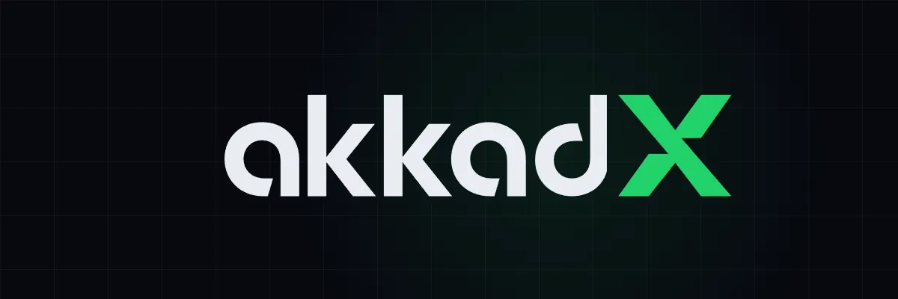
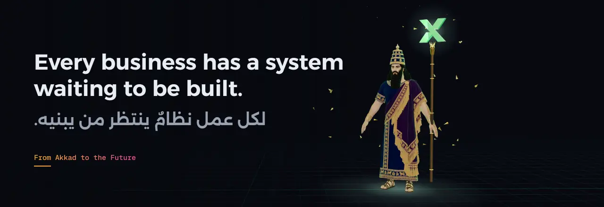
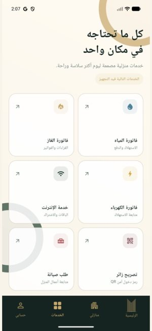
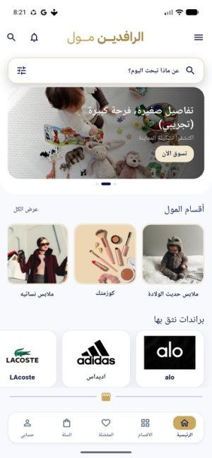
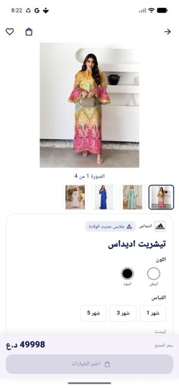
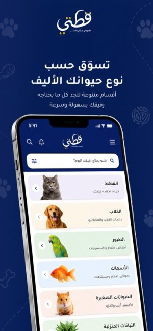
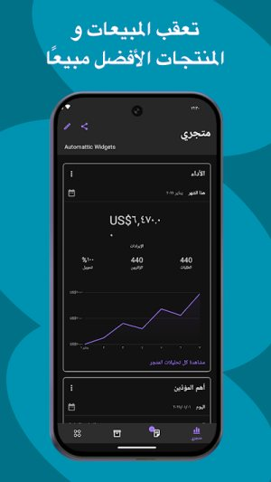
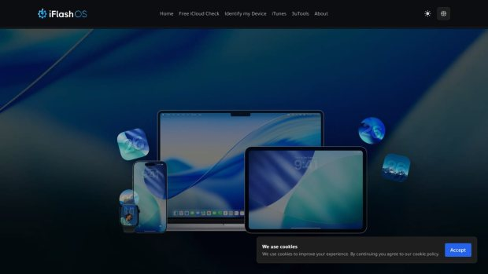

  

  

  
  
  

Software engineering and product studio from Iraq. Complex operations, turned into simple products. استوديو هندسة برمجيات ومنتجات من العراق. عمليات معقدة، تتحول إلى منتجات بسيطة.

  

## What we build · ماذا نبني

| | |
|---|---|
| **Commerce Engine** | Stores, apps and inventory that stay in sync. |
| **App Launch** | Flutter apps, from design to the App Store and Google Play. |
| **Business OS** | CRMs, clinic and operations systems. |
| **Custom Engineering** | Integrations, APIs and the systems in between. |
| **Care & Evolve** | We keep shipped products running and improving. |

## Products · المنتجات

| | |
|---|---|
| **[Watsy](https://watsy.me)** | OTP verification codes over WhatsApp, Telegram and SMS for Iraq. [Laravel](https://packagist.org/packages/watsy/laravel) · [Node.js](https://www.npmjs.com/package/@akkadx/watsy) |
| **akkadX Engineering** | Custom software, apps and business systems. Available now. |
| **Forge** | قريباً · Coming soon |
| **Cloud** | قريباً · Coming soon |

## Shipped · أعمال منشورة

Proof over promises. These are live. الدليل قبل الوعد.

<table>
<tr>
<td align="center" width="50%" valign="top">
 
<b>IQMDB</b> 
A community app for films and series  
   
 
</td>
<td align="center" width="50%" valign="top">
 
<b>Yarmouk City</b> 
Resident app for a residential compound  
   
 
</td>
</tr>
<tr>
<td align="center" width="50%" valign="top">
 
<b>Al Rafidain Mall</b> 
Multi-category shopping with variants  
   
 
</td>
<td align="center" width="50%" valign="top">
 
<b>Qittati</b> 
Pet supplies, delivered  
   
 
</td>
</tr>
<tr>
<td align="center" width="50%" valign="top">
 
<b>Store by akkadX</b> 
Run a store from your phone  
   

</td>
<td align="center" width="50%" valign="top">
 
<b>Oud Corsets</b> 
A brand store app  
   

</td>
</tr>
<tr>
<td align="center" width="50%" valign="top">
<b>iFlashOS</b> 
Apple firmware, searchable  
  

</td>
<td align="center" width="50%" valign="top">
<b>CRM by akkadX</b> 
Multi-tenant CRM with WhatsApp and Telegram  
  

</td>
</tr>
</table>

## Open source

| Project | | |
|---|---|---|
| [**watsy-laravel**](https://github.com/yahyakhalid/watsy-laravel) | Laravel package for Watsy OTP |  |
| [**@akkadx/watsy**](https://www.npmjs.com/package/@akkadx/watsy) | Node.js SDK for Watsy |  |
| [**morabaa-woo-sync**](https://github.com/yahyakhalid/morabaa-woo-sync) | WooCommerce stock sync with Morabaa POS |  |

---

  <a href="https://akkadx.com">akkadx.com</a> · <a href="mailto:hi@akkadx.com">hi@akkadx.com</a> 
  akkadX LLC · From Akkad to the Future · من أكد إلى المستقبل

